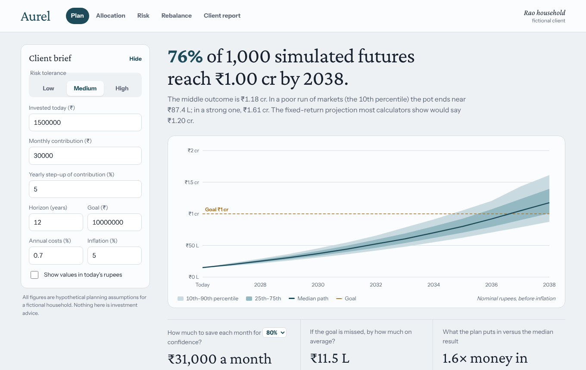
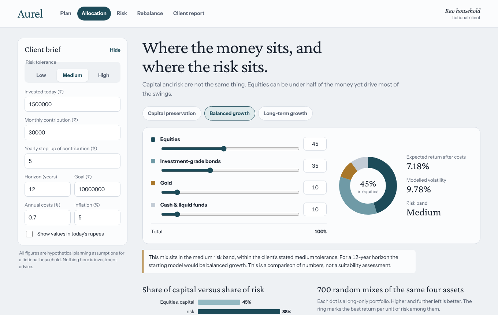

# Aurel — wealth plan review

**Live demo:** https://aurel-wealth-advisory.vercel.app

A goal-based financial planning workbench for a fictional Indian household. It answers the questions a wealth client actually asks — *will we get there, what if markets go badly, how much more should we save, and is this portfolio right for us?* — and turns the answers into a printable client review.



## What it does

| View | What you get |
|---|---|
| **Plan** | 1,000 seeded Monte Carlo paths drawn as a 10th–90th / 25th–75th percentile fan against the goal; probability of reaching the goal; average shortfall when it is missed; the monthly contribution needed for 70/80/90% confidence (solved by bisection); a cost-of-delay study. Values can be shown in nominal or today's rupees. |
| **Allocation** | Four-asset mix with presets or custom sliders; expected return after costs and covariance-based volatility; **share of capital versus share of risk** (risk contributions); 700 random long-only portfolios plotted as a frontier with the best return per unit of risk marked; a suitability comparison against the client's stated tolerance and horizon. |
| **Risk** | Five instant stress scenarios applied to today's portfolio; a track-record checker that takes monthly portfolio and benchmark returns and reports annualised return, volatility, Sharpe, Sortino, maximum drawdown, tracking error and information ratio, with growth-of-₹1 and drawdown charts. |
| **Rebalance** | Drift-band rebalancing: trades are proposed only when an asset drifts beyond the tolerance band, with turnover and dealing cost estimated. |
| **Client report** | A plain-English review letter generated from the live numbers. Print to PDF or download as text. |



## Method

- **Returns**: annual log-normal draws, `r = exp(μ − σ²/2 + σz) − 1`, with portfolio μ and σ from the weights, asset assumptions and a fixed correlation matrix. Contributions are added mid-year and can step up each year.
- **Reproducibility**: a seeded linear congruential generator, so the same inputs always give the same paths. Because the contribution solver reuses the same random numbers, the probability of success rises monotonically with contribution and bisection is valid.
- **Risk contribution**: `RCᵢ = wᵢ(Σw)ᵢ / σₚ²`, which sums to 100%.
- **Real terms**: every path value is divided by `(1 + inflation)^year`.

All capital-market assumptions are hypothetical. See [`CASE_STUDY.md`](CASE_STUDY.md) for scope and limitations.

## Run it

```bash
python3 -m http.server 8080   # then open http://localhost:8080
npm test                      # Node 20+; no dependencies to install
```

It is a static site with no build step, no API keys and no external requests (fonts are self-hosted).

## Project structure

```
index.html          markup for all five views
css/app.css         the whole visual system
src/engine.js       every calculation; pure functions, no DOM
src/app.js          UI wiring and rendering
src/charts.js       small dependency-free SVG chart kit
src/dom.js          formatting and routing helpers
tests/              node:test suite for the engine
fonts/              Crimson Pro and Instrument Sans (SIL Open Font Licence)
```

## Tests

13 tests cover the maths that matters: moments and the 100% constraint, risk contributions summing to one, fixed-projection identities, simulation reproducibility and band ordering, real-terms deflation, that the solved contribution really does reach the requested confidence (and ₹1,000 less does not), cost of delay, frontier validity, rebalancing netting to zero and respecting the band, stress arithmetic, and realised risk statistics.

---

Independent case study by Nishant Khanke. Fictional client and data; not investment advice.
